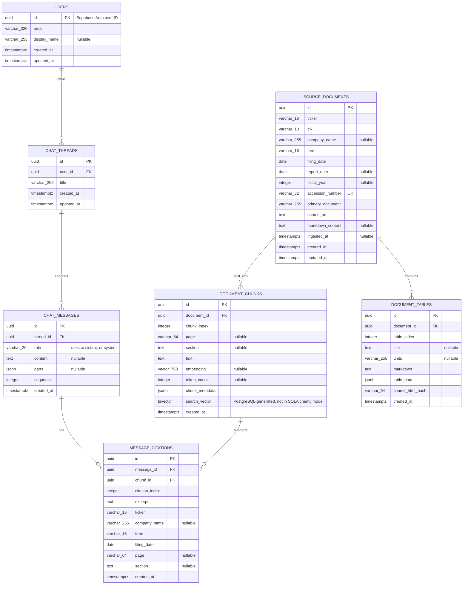

# Database ER Diagram

This diagram reflects the SQLAlchemy models in `backend/app/database/` and the
PostgreSQL-generated search column defined by the initial Alembic migration.

## Constraints and indexes

- `source_documents.accession_number` is unique.
- `(document_chunks.document_id, chunk_index)` is unique.
- `(document_tables.document_id, table_index)` is unique.
- `(chat_messages.thread_id, sequence)` is unique.
- `(message_citations.message_id, citation_index)` is unique.
- `document_chunks.search_vector` is generated from `text`; it has a GIN index.
- `document_chunks.embedding` is `vector(768)` and has an HNSW cosine index.
- Chat threads, messages, and citations have row-level security policies scoped
  to the owning authenticated user through `chat_threads.user_id`.

The full-text column and vector indexes are migration-defined PostgreSQL
features; `search_vector` is not declared as a regular SQLAlchemy model column.
